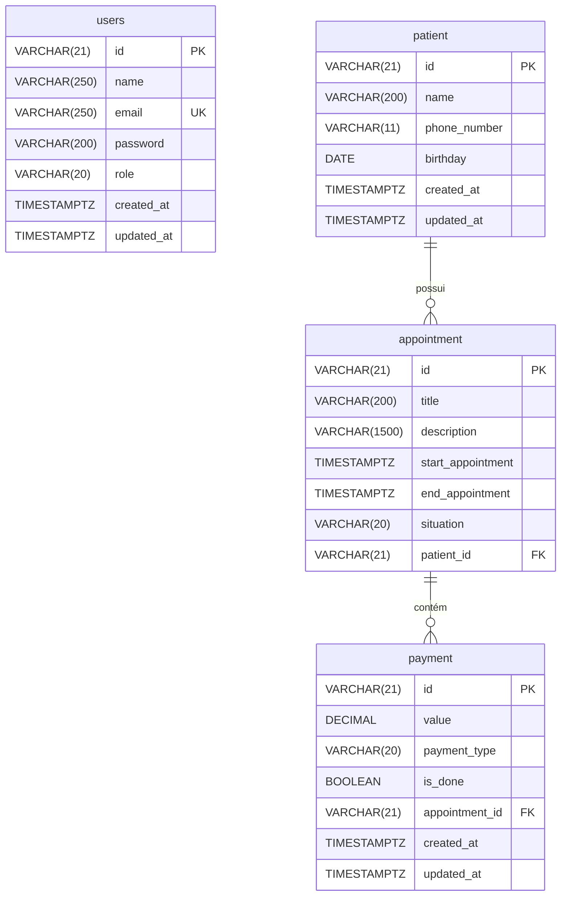

# Sistema de Agendamento Clínico

API RESTful completa desenvolvida com **Spring Boot 4 / Java 21**, projetada para a gestão de clínicas e consultórios médicos. O sistema oferece recursos completos de autenticação e autorização stateless com **Spring Security** e **JWT**, gerenciamento inteligente de pacientes e consultas médicas, controle de disponibilidade de horários e gestão de pagamentos.

---

## 📌 Sumário

- [Visão Geral](#-visão-geral)
- [Tecnologias Utilizadas](#-tecnologias-utilizadas)
- [Arquitetura e Estrutura de Pastas](#-arquitetura-e-estrutura-de-pastas)
- [Modelagem de Dados (ERD)](#-modelagem-de-dados-erd)
- [Principais Regras de Negócio](#-principais-regras-de-negócio)
- [Documentação da API (Endpoints)](#-documentação-da-api-endpoints)
  - [Autenticação](#1-autenticação-auth)
  - [Pacientes](#2-pacientes-patient)
  - [Agendamentos](#3-agendamentos-appointment)
  - [Pagamentos](#4-pagamentos-payment)
- [Tratamento de Erros e Exceções](#-tratamento-de-erros-e-exceções)
- [Como Executar o Projeto](#-como-executar-o-projeto)
  - [Pré-requisitos](#pré-requisitos)
  - [Passo a Passo](#passo-a-passo)
- [Testes](#-testes)

---

## 🚀 Visão Geral

O projeto resolve o fluxo operacional de clínicas médicas integrando:
1. **Segurança Reforçada**: Controle de usuários e papéis (`ADMIN`, `USER`) com autenticação baseada em tokens JWT.
2. **Cadastro Inteligente de Pacientes**: Identificação e reaproveitamento automático de registros existentes durante o agendamento para evitar duplicidade.
3. **Agendamento com Prevenção de Conflitos**: Validação automática de choques de horário (janela mínima de 1 hora entre consultas).
4. **Ciclo de Vida da Consulta**: Acompanhamento de status (`ACTIVE`, `RESCHEDULED`, `COMPLETED`) com registro de carimbo de término.
5. **Módulo Financeiro**: Registro de pagamentos vinculados a consultas, controle de status de quitação (`isDone`) e múltiplos métodos (PIX, Dinheiro, Cartões).
6. **Chaves Primárias com NanoID**: Uso de identificadores compactos, únicos e seguros (21 caracteres) em vez de inteiros sequenciais legados.

---

## 🛠 Tecnologias Utilizadas

- **Linguagem**: [Java 21](https://www.oracle.com/java/technologies/downloads/#java21) (LTS)
- **Framework Principal**: [Spring Boot 4.1.1](https://spring.io/projects/spring-boot)
- **Segurança**: [Spring Security](https://spring.io/projects/spring-security) com [Auth0 Java-JWT (4.6.1)](https://github.com/auth0/java-jwt)
- **Persistência**: [Spring Data JPA](https://spring.io/projects/spring-data-jpa) & [Hibernate](https://hibernate.org/)
- **Banco de Dados**: [PostgreSQL](https://www.postgresql.org/)
- **Migrações**: [Flyway Database Migration](https://flywaydb.org/)
- **Gerador de ID**: [JNanoID (2.0.0)](https://github.com/aventrix/jnanoid)
- **Documentação Interativa**: [Springdoc OpenAPI / Swagger UI (3.1.0)](https://springdoc.org/)
- **Utilitários**: [Lombok](https://projectlombok.org/)
- **Containerização**: [Docker](https://www.docker.com/) & [Docker Compose](https://docs.docker.com/compose/)
- **Testes**: JUnit 5 & Mockito

---

## 📂 Arquitetura e Estrutura de Pastas

O código-fonte segue uma organização modular por domínio (package-by-feature):

```text
src/main/java/dev/gustavovs/maisspringsecurity/
├── appointment/                 # Domínio de Agendamento de Consultas
│   ├── dto/
│   │   ├── request/             # DTOs de entrada (criação e atualização)
│   │   └── response/            # DTOs de saída
│   ├── Appointment.java         # Entidade JPA
│   ├── AppointmentController.java
│   ├── AppointmentRepository.java
│   ├── AppointmentService.java
│   └── AppointmentSituation.java # Enum: ACTIVE, RESCHEDULED, COMPLETED
├── auth/                        # Autenticação e Emissão de Tokens
│   ├── dto/                     # AuthResponse (token e nome do usuário)
│   ├── AuthConfig.java          # Implementação de UserDetailsService
│   ├── AuthController.java
│   └── AuthService.java
├── commom/                      # Classes base reutilizáveis
│   └── BaseEnity.java           # Superclasse com NanoID e timestamps de auditoria
├── config/                      # Configurações do Spring Security e JWT
│   ├── SecurityConfig.java      # Filtros, CORS, CSRF e regras de rotas
│   ├── SecurityFilter.java      # Interceptador OncePerRequestFilter para validação JWT
│   └── TokenConfig.java         # Geração e validação de tokens HMAC256
├── exception/                   # Tratamento centralizado de erros
│   ├── exceptions/              # Exceções customizadas de negócio
│   └── GlobalExceptionHandler.java # @RestControllerAdvice com RFC 7807 (ProblemDetail)
├── patient/                     # Domínio de Pacientes
│   ├── dto/
│   │   ├── request/
│   │   └── response/
│   ├── Patient.java
│   ├── PatientController.java
│   ├── PatientRepository.java
│   └── PatientService.java
├── payment/                     # Domínio de Pagamentos
│   ├── dto/
│   │   ├── request/
│   │   └── response/
│   ├── Payment.java
│   ├── PaymentController.java
│   ├── PaymentRepository.java
│   ├── PaymentService.java
│   └── PaymentType.java         # Enum: CASH, PIX, DEBIT_CARD, CREDIT_CARD
└── user/                        # Domínio de Usuários do Sistema
    ├── dto/request/
    ├── User.java                # Entidade que implementa UserDetails
    ├── UserController.java
    ├── UserRepository.java
    ├── UserRole.java            # Enum: ADMIN, USER
    └── UserService.java
```

---

## 🗄 Modelagem de Dados (ERD)



---

## 🧠 Principais Regras de Negócio

1. **Geração de Identificadores (NanoID)**:
   - Toda entidade herdada de `BaseEnity` ou gerenciada (`User`, `Patient`, `Appointment`, `Payment`) recebe no ciclo `@PrePersist` um NanoID de 21 caracteres gerado por `NanoIdUtils.randomNanoId()`.
2. **Reaproveitamento de Pacientes**:
   - Ao criar uma consulta (`POST /appointment`), o sistema busca pacientes existentes com o mesmo número de telefone. Caso encontre um paciente com o mesmo nome e data de nascimento, vincula a consulta ao cadastro existente em vez de criar um duplicado.
3. **Conflito de Agendamentos**:
   - Nenhuma consulta pode ser marcada ou reagendada caso já exista outra com situação `ACTIVE` ou `RESCHEDULED` com início dentro do intervalo de 1 hora anterior ao horário solicitado. Em caso de choque, lança `AppointmentStartTimeNotAvailableException` (HTTP 409).
4. **Ciclo de Reagendamento e Finalização**:
   - Alterar o `startAppointment` via PATCH em uma consulta altera automaticamente sua situação para `RESCHEDULED`.
   - Ao invocar a rota `/appointment/complete/{id}`, a consulta passa para `COMPLETED` e preenche `endAppointment` com o horário atual (Timezone `-03:00`), caso ainda não definido.
5. **Autenticação Stateless**:
   - O token JWT gerado no login possui validade de **12 horas**, assinado com HMAC-256 e emissor `mais-springsecurity`. Todas as rotas (exceto `/auth/login` e `/auth/register`) requerem o header `Authorization: Bearer <TOKEN>`.

---

## 📖 Documentação da API (Endpoints)

### 1. Autenticação (`/auth`)

| Método | Endpoint | Descrição | Acesso |
| :--- | :--- | :--- | :--- |
| `POST` | `/auth/register` | Cadastra um novo usuário no sistema | Público |
| `POST` | `/auth/login` | Realiza login e retorna o token JWT | Público |

#### Exemplo de Registro (`POST /auth/register`):
```json
{
  "name": "Dr. Carlos Santos",
  "email": "carlos@clinica.com",
  "password": "senhaSegura123"
}
```

#### Resposta (`201 Created`):
```json
{
  "token": "eyJhbGciOiJIUzI1NiIsInR5cCI6IkpXVCJ9...",
  "name": "Dr. Carlos Santos"
}
```

---

### 2. Pacientes (`/patient`)

Todas as requisições exigem cabeçalho `Authorization: Bearer <token>`.

| Método | Endpoint | Descrição | Status Sucesso |
| :--- | :--- | :--- | :--- |
| `GET` | `/patient/{phoneNumber}` | Busca pacientes por número de telefone (11 dígitos) | `200 OK` |
| `PATCH` | `/patient/{id}` | Atualização parcial dos dados do paciente | `201 Created` |
| `DELETE` | `/patient/{id}` | Remove um paciente da base de dados | `204 No Content` |

#### Exemplo de Atualização de Paciente (`PATCH /patient/{id}`):
```json
{
  "name": "Mariana Alves Atualizada",
  "phoneNumber": "81988887777"
}
```

---

### 3. Agendamentos (`/appointment`)

Todas as requisições exigem cabeçalho `Authorization: Bearer <token>`.

| Método | Endpoint | Descrição | Status Sucesso |
| :--- | :--- | :--- | :--- |
| `POST` | `/appointment` | Cria um agendamento e cadastra/vincula o paciente | `201 Created` |
| `GET` | `/appointment/{situation}` | Filtra consultas por situação (`ACTIVE`, `RESCHEDULED`, `COMPLETED`) | `200 OK` |
| `GET` | `/appointment/by/day/{day}` | Filtra consultas ativas/reagendadas pelo dia do mês | `200 OK` |
| `GET` | `/appointment/by/month/{month}` | Filtra consultas ativas/reagendadas pelo mês | `200 OK` |
| `GET` | `/appointment/by/year/{year}` | Filtra consultas pelo ano | `200 OK` |
| `PATCH` | `/appointment/{id}` | Atualiza título, descrição ou data do agendamento | `201 Created` |
| `PATCH` | `/appointment/complete/{id}` | Marca consulta como concluída (`COMPLETED`) | `201 Created` |
| `GET` | `/appointment/{id}/payments` | Lista todos os pagamentos vinculados a essa consulta | `200 OK` |
| `DELETE` | `/appointment/{id}` | Exclui a consulta e pagamentos em cascata | `204 No Content` |

#### Exemplo de Criação de Agendamento (`POST /appointment`):
```json
{
  "title": "Consulta Odontológica Inicial",
  "description": "Avaliação geral e limpeza",
  "startAppointment": "2026-11-20T14:30:00",
  "patientName": "Fernanda Lima",
  "patientPhoneNumber": "81999991122",
  "patientBirthday": "1994-03-22"
}
```

#### Resposta (`201 Created`):
```json
{
  "id": "4f_K-hXzZ9wQ1L2m8kP3a",
  "title": "Consulta Odontológica Inicial",
  "description": "Avaliação geral e limpeza",
  "startAppointment": "14:30 - 20/11/2026",
  "endAppointment": null,
  "situation": "ACTIVE",
  "patientName": "Fernanda Lima",
  "patientPhoneNumber": "81999991122"
}
```

---

### 4. Pagamentos (`/payment`)

Todas as requisições exigem cabeçalho `Authorization: Bearer <token>`.

| Método | Endpoint | Descrição | Status Sucesso |
| :--- | :--- | :--- | :--- |
| `POST` | `/payment?appointmentId={appointmentId}` | Registra um pagamento associado a um agendamento | `201 Created` |
| `PATCH` | `/payment/{id}` | Altera valor ou forma de pagamento | `201 Created` |
| `PATCH` | `/payment/{id}/confirm` | Marca o pagamento como liquidado (`isDone = true`) | `201 Created` |
| `DELETE` | `/payment/{id}` | Remove um registro de pagamento | `204 No Content` |

#### Tipos de Pagamento (`paymentType`):
- `CASH`: Dinheiro em espécie
- `PIX`: Transferência PIX
- `DEBIT_CARD`: Cartão de Débito
- `CREDIT_CARD`: Cartão de Crédito

#### Exemplo de Criação de Pagamento (`POST /payment?appointmentId=4f_K-hXzZ9wQ1L2m8kP3a`):
```json
{
  "value": 250.00,
  "paymentType": "PIX",
  "isDone": false
}
```

---

## ⚠️ Tratamento de Erros e Exceções

A API adota o padrão **RFC 7807 (Problem Details)** para formatação de erros:

```json
{
  "type": "about:blank",
  "title": "Start time not available.",
  "status": 409,
  "detail": "Appointment start time not available.",
  "instance": "/appointment"
}
```

### Principais Códigos HTTP Mapeados:
- `400 Bad Request`: Erros de validação nos campos (`MethodArgumentNotValidException`). Detalhes adicionais são inseridos no campo `Invalid fields`.
- `404 Not Found`:
  - `AppointmentNotFoundException`: Consulta não encontrada para o ID informado.
  - `PatientNotFoundException`: Paciente não encontrado para o ID informado.
  - `PatientPhoneNumberNotFoundException`: Nenhum paciente localizado com o telefone informado.
  - `PaymentNotFoundException`: Pagamento não encontrado.
- `409 Conflict`:
  - `AppointmentStartTimeNotAvailableException`: Horário indisponível para consulta (choque de agenda).
  - `EmailAlreadyInUseException`: Tentativa de cadastrar um usuário com e-mail já existente.

---

## 💻 Como Executar o Projeto

### Pré-requisitos
- **Java 21** instalado e configurado nas variáveis de ambiente (`JAVA_HOME`).
- **Docker** e **Docker Compose** instalados e em execução.
- Git para clonar o repositório.

### Passo a Passo

1. **Clone o repositório:**
   ```bash
   git clone https://github.com/seu-usuario/mais-springsecurity.git
   cd mais-springsecurity
   ```

2. **Suba o banco de dados PostgreSQL com Docker Compose:**
   O repositório já inclui o arquivo `compose.yaml` com as configurações do banco:
   ```bash
   docker compose up -d
   ```
   *O container `mais-springsecurity-db` será iniciado na porta `5432` com usuário `postgres` e senha `admin`.*

3. **Crie o banco de dados (se necessário):**
   Conecte-se ao PostgreSQL ou crie o banco definido na connection string (`scheduling-system`):
   ```bash
   docker exec -it mais-springsecurity-db psql -U postgres -c "CREATE DATABASE \"scheduling-system\";"
   ```

4. **Execute a aplicação:**
   - **Linux / macOS:**
     ```bash
     ./mvnw spring-boot:run
     ```
   - **Windows:**
     ```cmd
     mvnw.cmd spring-boot:run
     ```

   *O Flyway executará automaticamente as migrações em `src/main/resources/db/migration` ao subir a aplicação.*

5. **Acesse a Documentação Swagger / OpenAPI:**
   - Interface interativa: [http://localhost:8080/swagger-ui/index.html](http://localhost:8080/swagger-ui/index.html)
   - Especificação JSON: [http://localhost:8080/v3/api-docs](http://localhost:8080/v3/api-docs)

---

## 🧪 Testes

Para executar os testes unitários da aplicação:

- **Linux / macOS:**
  ```bash
  ./mvnw test
  ```
- **Windows:**
  ```cmd
  mvnw.cmd test
  ```

---

## 📄 Licença

Este projeto foi desenvolvido para fins didáticos e profissionais como uma demonstração robusta de arquitetura Spring Boot com Spring Security e PostgreSQL.
